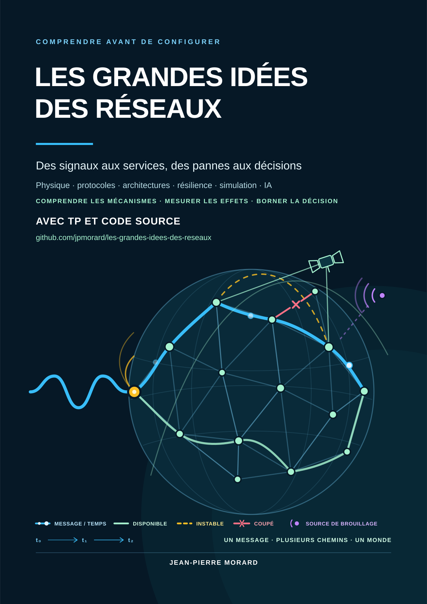

# Les Grandes Idées des Réseaux — livres, TP et code source

<p align="center"><a href="cover.svg"></a></p>

Le dépôt compagnon du livre de **Jean-Pierre MORARD** : comprendre un
mécanisme, formuler une prédiction, exécuter une expérience et expliquer ses
limites. L'innovation suit ce même fil : du besoin à l'hypothèse, puis au
prototype, aux essais et au partage des résultats.

**Les six livres et guides sont disponibles en PDF sur la [page de lecture de la collection](livres/README.md).**

## Les livres

<table>
  <tr>
    <td align="center"><a href="livres/La_passion_avant_la_carriere_Parcours_d_un_ingenieur_fr.pdf"></a><br>Récit</td>
    <td align="center"><a href="livres/Treize_idees_pour_comprendre_les_reseaux_fr.pdf"></a><br>Initiation</td>
    <td align="center"><a href="livres/Reseaux_Concevoir_experimenter_et_verifier_fr.pdf"></a><br>Ingénierie</td>
  </tr>
  <tr>
    <td align="center"><a href="livres/IA_pour_les_reseaux_De_la_question_a_la_solution_fr.pdf"></a><br>Intelligence artificielle</td>
    <td align="center"><a href="livres/Mathematiques_ENSI_1986_option_TA_Sujets_et_corriges_fr.pdf"></a><br>Complément ENSI</td>
    <td align="center"><a href="livres/Lire_les_mathematiques_de_l_IA_Notations_et_premiers_articles_fr.pdf"></a><br>Guide mathématique</td>
  </tr>
</table>

Le [schéma 3D des risques de l’innovation](assets/innovation_risques_marche_produit_technologie_3d_fr.svg)
relie **marché, produit et technologie**. C’est une grille qualitative pour
choisir les observations à recueillir, sans calcul de probabilité d’échec.
Le [portefeuille de dix pistes](assets/innovation_portefeuille_dix_pistes_renouvellement_fr.svg)
montre comment arrêter, approfondir et remplacer les pistes en continu.

## Choisir un parcours

Commencer par le [parcours de curiosité et de raisonnement](parcours_curiosite_raisonnement_reseaux_fr.md) :
observer, chercher une idée, expérimenter, puis relier ce que l'on a compris.
Quelques lectures de mathématiques et de réseaux accompagnent ce chemin.

Le [cahier de travaux pratiques](travaux_pratiques_reseaux_fr.md) rassemble
les laboratoires L00 à L28. Les quatre collections ci-dessous apportent
**16 notebooks Jupyter**, des scripts Python, des jeux de données synthétiques,
des résultats conservés et leurs vérificateurs. Certains autres exercices du
cahier demandent des logiciels ou des équipements indiqués dans leur énoncé.

| Collection | Sujets | Pour commencer |
|---|---|---|
| [Fondamentaux](core_network_labs/README.md) | latence, QoS, convergence, BGP/ROV ; 3 notebooks | [Latence et QoS](core_network_labs/notebooks/tp_latence_qos.ipynb) |
| [Simulation réseau](network_simulation_labs/README.md) | DNS, DHCP, sous-réseaux, voix, capture, diagnostic, découverte, modulation et FANET ; 9 notebooks | [DNS](network_simulation_labs/notebooks/tp_dns_resolution.ipynb) |
| [Apprentissage automatique](machine_learning_labs/README.md) | classification rare, retour/TD, DQN et relais, SVD/ACP/RPCA/MIMO ; 4 notebooks | [Retour et TD](machine_learning_labs/notebooks/tp_rl_retour_q_td.ipynb) |
| [Chiffrement homomorphe](chiffrement_homomorphe_labs/README.md) | L28 : agrégation avec Paillier, arithmétique et limites | [Script Paillier](chiffrement_homomorphe_labs/tp_paillier_agregation_fr.py) |

Le [dossier ACP, SVD et représentations réseau](representations_acp_svd_reseaux_fr.md)
explique le choix des variantes et leurs limites. Le
[notebook SVD radio](machine_learning_labs/notebooks/svd_radio.ipynb)
met ces représentations à l’épreuve sur des données synthétiques.

## Premier TP, sans dépendance

Commencer par le [guide des quatre premiers TP](premiers_pas_reseaux_fr.md).
Il associe prédictions, dessins, scripts et interprétation. Python 3.10 ou plus
suffit, sans téléchargement de bibliothèque :

~~~bash
git clone https://github.com/jpmorard/les-grandes-idees-des-reseaux.git
cd les-grandes-idees-des-reseaux
python3 -m core_network_labs.premiers_pas_reseaux_fr latence
python3 -m core_network_labs.premiers_pas_reseaux_fr files
python3 -m core_network_labs.premiers_pas_reseaux_fr decouverte
python3 -m core_network_labs.premiers_pas_reseaux_fr chemins
~~~

Ces modèles n'accèdent à aucun réseau et ne modifient aucun fichier.
Les autres fiches L01 à L19 sont des projets à instancier ; le cahier indique
leur statut. Les notebooks apportent des expériences complémentaires.

## Prolonger avec le chiffrement homomorphe

Après les premiers TP, le [guide Paillier](chiffrement_homomorphe_labs/README.md)
permet d'explorer le calcul sur des compteurs chiffrés :

~~~bash
python3 -m chiffrement_homomorphe_labs.tp_paillier_agregation_fr
python3 -m chiffrement_homomorphe_labs.tp_paillier_agregation_fr --check
~~~

Les minuscules paramètres publics sont volontairement non sûrs : ce code
enseigne l'arithmétique et ne protège aucune donnée. Il est partiellement
homomorphe, pas FHE.

## Ouvrir les notebooks

Le projet ML fournit un environnement commun verrouillé (Python 3.12 à 3.14).
Après installation de [uv](https://docs.astral.sh/uv/getting-started/installation/),
depuis la racine du dépôt :

```bash
uv sync --project machine_learning_labs --python 3.12 --locked
uv run --project machine_learning_labs --locked jupyter lab .
```

L'installation initiale télécharge les dépendances. Les modèles pédagogiques
et leurs données fonctionnent ensuite localement ; chaque collection précise
ses prérequis et ses commandes de vérification. Les tests unitaires sont
exécutables sans lancer les campagnes d'apprentissage complètes :

```bash
python3 -m unittest discover -s core_network_labs/tests
python3 -m unittest discover -s network_simulation_labs/tests
uv run --project machine_learning_labs --locked pytest machine_learning_labs/tests -q
```

## Résultats, sources et portée

Les données sont synthétiques. Les résultats conservés illustrent des modèles
et des hypothèses déclarées ; ils ne prouvent ni performance terrain ni
qualification d'un équipement. Les notebooks sont publiés sans sorties pour
inviter à les exécuter. Les expériences réseau décrites dans le cahier doivent
rester dans un banc autorisé et isolé.

- [Sources et attributions des TP ML](machine_learning_labs/SOURCES.md).
- [Sources du complément sur le chiffrement homomorphe](chiffrement_homomorphe_reseaux_sources_fr.md).
- [Inventaire SHA-256 des supports](les_grandes_idees_des_reseaux_sources.json).

Ce dépôt accompagne l'édition 1.0, révision 2, du livre. Les six PDF de la
collection sont accessibles depuis la [page de lecture](livres/README.md).
Les notebooks et scripts sont autonomes selon leurs prérequis.
